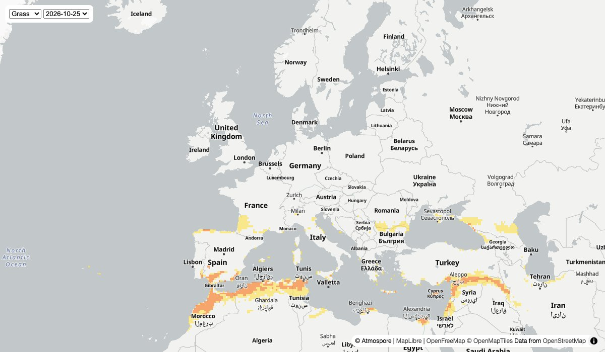

# Pollen map with map tiles

A global, day-by-day pollen forecast layer on a MapLibre map, in about 150 lines: a tiny backend that keeps your API key secret, and one HTML page.



The full walkthrough, including how map tiles and z/x/y URLs work, is in the guide: **[Add a live pollen map to your website or app](https://atmospore.com/article/map-tiles)**.

## What you need

- An Atmospore API key on a **paid plan** (map tiles are included in all paid plans): [atmospore.com/plans](https://atmospore.com/plans)
- Node.js 18 or newer, **or** Python 3 with `pip`

No other accounts: the map library ([MapLibre GL JS](https://maplibre.org)) and the base map ([OpenFreeMap](https://openfreemap.org)) are free and need no key.

## Run it

**Node.js** (no packages to install):

```sh
ATMOSPORE_API_KEY=your-key node server.mjs
```

**Python:**

```sh
pip install -r requirements.txt
ATMOSPORE_API_KEY=your-key python server.py
```

On Windows (PowerShell), set the key first: `$env:ATMOSPORE_API_KEY="your-key"; node server.mjs`

Then open <http://localhost:3000>. Use the menus to switch species and day, and click a coloured cell to see its value.

## How it works

1. **`server.mjs` / `server.py`** calls `GET https://pollenapi.com/v1/map-tiles` with your key and serves the answer at `/pollen-tiles`. It reuses the answer for an hour, so the page makes at most 24 API calls a day however many people use it.
2. **`index.html`** fetches `/pollen-tiles` and gives the signed tile URL to MapLibre as a vector source. The browser loads the tiles straight from Atmospore's CDN, with no key and no extra headers: the URLs are signed and valid for about 6 hours.
3. Cells are coloured by risk level with a `step` expression. Switching species only changes the colours (no download); switching day swaps in that day's tile URL from `steps[]`.

| | Moderate from | High from | Very high from |
|---|---|---|---|
| Trees | 15 | 90 | 1500 |
| Grass | 5 | 20 | 200 |
| Weeds | 10 | 50 | 500 |

Values are grains/m³. A species with no pollen in a cell is left out of the tile, so treat a missing value as 0 (that's the `coalesce` in the expression).

Only calls to `/v1/map-tiles` count against your quota; tile downloads are free.

## Troubleshooting

**The map shows but there is no pollen layer, and `/pollen-tiles` says `Error: Atmospore answered 403`.**
The key is missing, invalid, or on a free plan. Check that `ATMOSPORE_API_KEY` is set in the same terminal you start the server from. Free plans get `403` with an upgrade link; map tiles need a paid plan.

**Some areas have no colour.**
Either the pollen there is below the moderate level (left transparent on purpose) or it's ocean. Click a land cell to see its value.

**Squares when zoomed in close.**
That is the real resolution of the forecast: cells of 0.25°, about 28 km.

## Use it in your own app

- Already have a backend? Add the `/pollen-tiles` route to it; nothing else changes.
- Mapbox GL JS: replace `maplibregl` with `mapboxgl` and set your Mapbox token.
- Reference: [`GET /v1/map-tiles` in the API docs](https://atmospore.com/api-docs#map-tiles) and the [OpenAPI spec](https://pollenapi.com/openapi.json).
